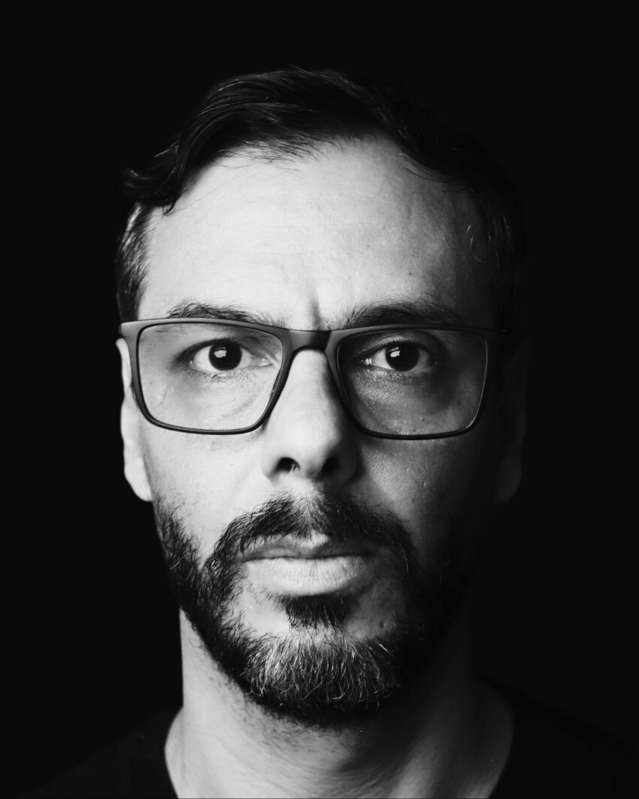

# Sobre o Autor

Felipe Fontoura entregou software que não podia falhar: para 20 milhões de clientes, para aeronaves, para satélites. Drivers de kernel Linux para hardware de comunicação via satélite no INPE. Sete anos de sistemas em produção na Embraer. Um checkout global com mais de cinco milhões de reservas por ano na TUI. Depois, no fim de 2025, uma fintech cripto com 13 aplicações em 70 dias, sozinho, com agentes de IA trabalhando a partir das specs que este livro ensina a escrever.

Hoje aplica engenharia de IA em projetos com mais de 3.500 engenheiros em mais de 200 squads, simultaneamente: acha o que funciona, conecta os times que resolvem o mesmo problema e transforma isso em padrões que a organização inteira usa. Já ensinou programação a 30 mil alunos, e a conta segue.

## Se você lidera um time de engenharia

Spec-Driven Development é um degrau de uma subida maior. Os agentes vão de sugerir código a mudar arquivos a pedido, depois a pegar a tarefa inteira e abrir o pull request, e por fim a entregar sozinhos atrás de gates em que você confia. Até onde um time deve subir depende de quanto custa um erro; para a maioria dos times, a meta realista hoje é o degrau do pull request, e o método deste livro é o que torna possível o próximo.

*Se você está levando agentes para um time de engenharia, quero saber como está sendo:* **[felipefontoura.com/contact](https://felipefontoura.com/contact/?utm_source=sdd-book&utm_medium=referral&utm_campaign=about-the-author&utm_content=pt-br)**
